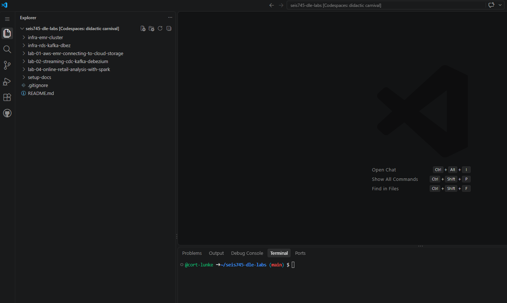
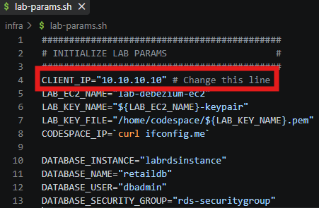
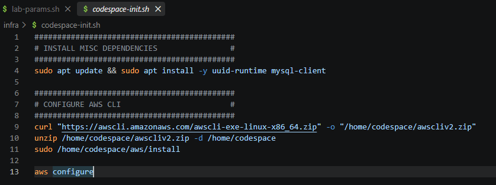
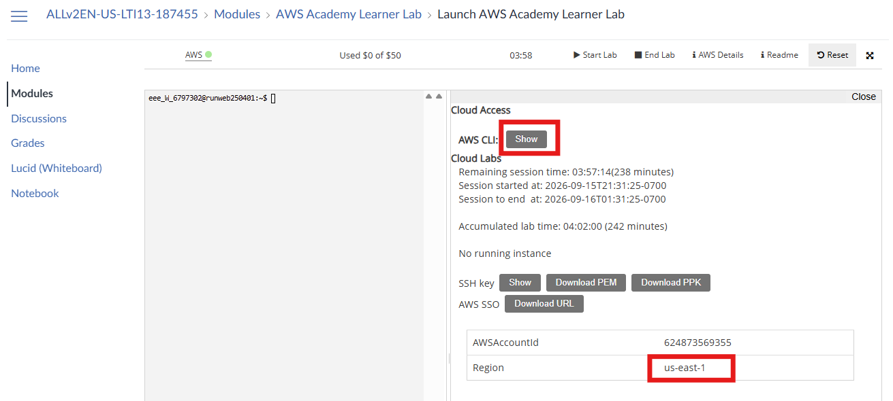
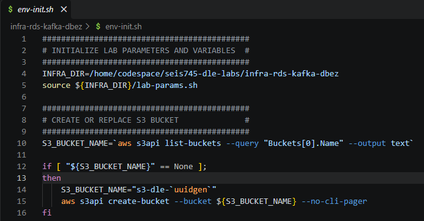
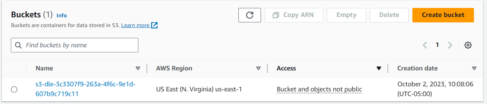
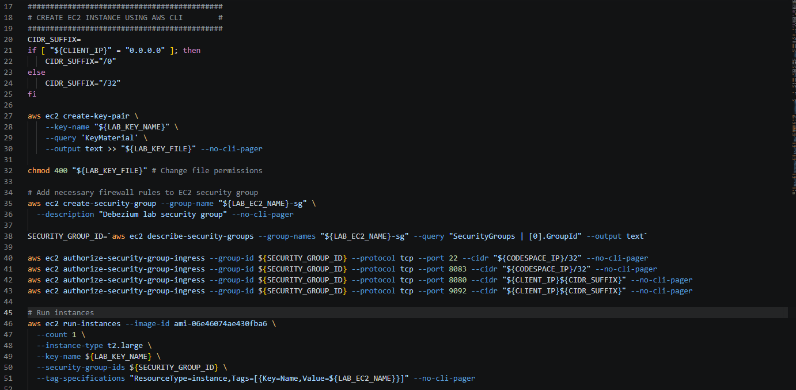
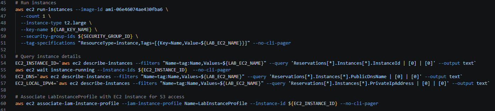
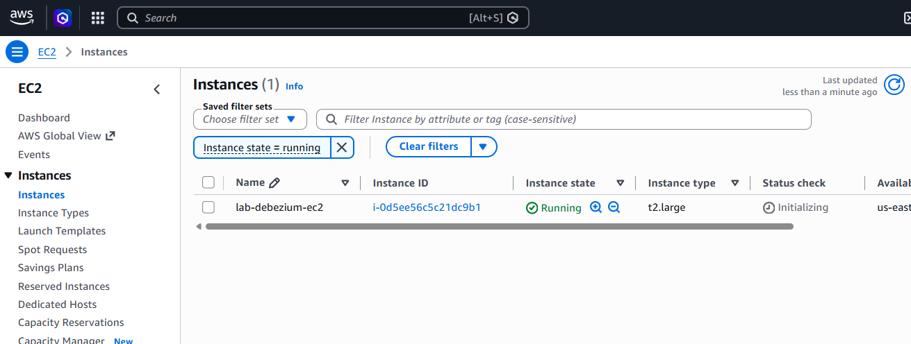

# 

## Section 1: Set environment variables and create an S3 bucket (or reuse an existing one)

1)  Once you have opened your Codespace and cloned the repository, it
    should look something like this:

2)  First, open lab-params.sh You need to update the CLIENT_IP
    variable with your IP address shown at
    <https://checkip.amazonaws.com/>. Don't forget to save lab-params.sh
    after updating the variable (Ctrl+S on Windows)

3)  Next, run codespace-init.sh to install lab dependencies and the
    AWS CLI. While it does not hurt to install the AWS CLI a second
    time, if you have previously installed the AWS CLI in this
    environment you may simply run the first and last executable lines
    (sudo apt and aws configure).

> Just like Lab 1, you will need to get your AWS access key id, secret
> access key, and session token from your AWS Academy environment.
>
> 
>
> 

4)  Now that you have configured the AWS CLI and set necessary lab
    variables, we can start deploying resources. Open env-init.sh to
    start deploying lab infrastructure. The following lines of code
    initialize lab parameters, queries for an existing S3 bucket using
    the AWS CLI, and creates a new S3 bucket if one does not yet exist.

5)  You may double check that your bucket was created at
    <https://s3.console.aws.amazon.com/s3>:

## Section 2: Deploy an Amazon EC2 Instance for hosting containerized services

1)  The next step in env-init.sh deploys an EC2
    instance leveraging the AWS CLI. Run this section of code to turn
    your client IP address into a proper CIDR range, create a keypair
    for authentication, create a security group and corresponding
    firewall rules, and run the instance:

    

2)  This next section queries instance attributes and assigns them to variables. This includes the instance
    id, public domain name, and local IP address for your EC2 instance.
    It also associates the instance with the security profile
    LabInstanceProfile provided by Vocareum. We will use this to
    facilitate connectivity with the instance and interoperability with
    other AWS resources later in the lab.

    

3)  Make sure the EC2 instance is running and review the configuration in the
    AWS console at <https://us-east-1.console.aws.amazon.com/ec2/>:

    
