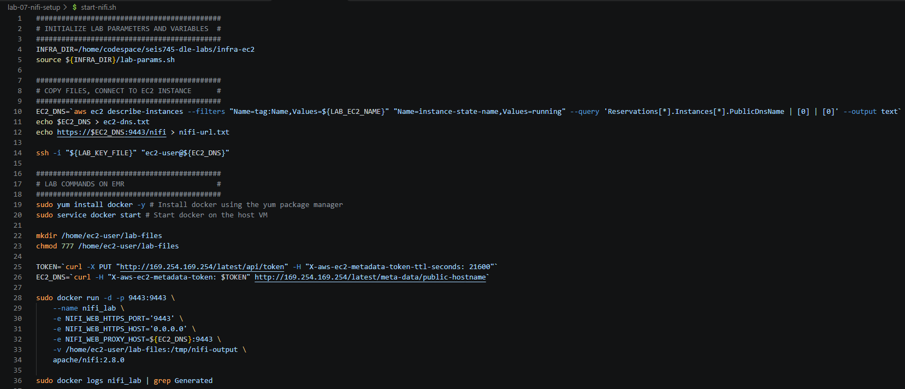
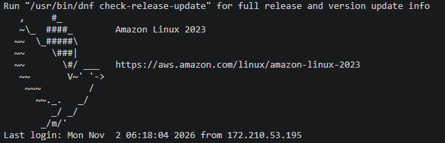
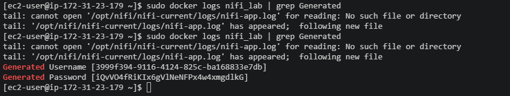
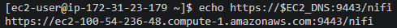
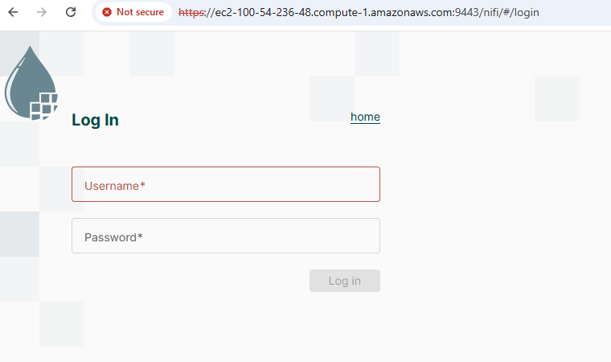

## Introduction

In this lab, you will be starting your own NiFi server running on an 
EC2 instance in the Amazon Web Services cloud (AWS).  We will deploy 
NiFi version 2 using a recent container image.  You are far enough along
that you will be given instructions to spin up and log into your NiFi web
console.  Beyond that, you must use instructions and the demo given in class
to configure your own NiFi dataflow, pulling data from a remote web service.

We will continue to use a GitHub Codespace to automate infrastructure
deployment and interact with cloud resources.

## Pre-requisites

You should have a Codespace environment up and running **in your
browser** with the following git repository cloned and open:
https://github.com/UST-SEIS-745-DLE-Labs/seis745-dle-labs.

Additionally, you should be familiar with the infrastructure as code and
lab conventions we have used previously in class. When running the lab
you will be interactively copying lines from bash scripts and pasting
them into your bash terminal. Pay attention to the code you are
executing and the output as you automate infrastructure
deployment in AWS.

## Section 1: Clone or pull git repository and stand up lab infrastructure

Complete all steps within setup-docs to ensure your AWS lab environment is up and running, your GitHub Codespace is running and accessible in your browser, and you have either cloned ('git clone' in the CLI or command pallete) or pulled the latest changes ('git pull').  The repository url is [**https://github.com/UST-SEIS-745-DLE-Labs/seis745-dle-labs**](https://github.com/UST-SEIS-745-DLE-Labs/seis745-dle-labs)

The directory for this particular lab is **lab-07-nifi-setup**.

## Section 2: Deploy lab infrastructure

Infrastructure is managed in a separate repo folder for reusability.  This lab relies on the **infra-ec2** folder.  Follow instructions in infra-ec2/README.md (open in GitHub or Open Preview in VS Code / Codespace) to deploy necessary lab infrastructure.

## Section 3: Start NiFi
Execute commands in the provided start-nifi.sh script block by block.  Lab commands initialize lab environment variables, connct to the remote EC2 instance using SSH, install docker on that EC2 instance, and run the NiFi Docker container.

Make sure that SSH works correctly and you see the welcome screen for Amazon Linux:

When you get to the end, repeatedly query log files using docker logs nifi_lab and grep.  Once NiFi is up and running, you should see a generated username and password that you may use to login.

For convenience, the URL of your NiFi instance is printed to standard out at the end of the script.  Access YOUR url (it will be different than the one in the screenshot) and use your username/password from the previous step to login.

URL printed to standard out:

Note that you will have to ignore the TLS certificate errors and proceed to the URL.

Once logged in, your browser should look like this (again, with a slightly different URL):
