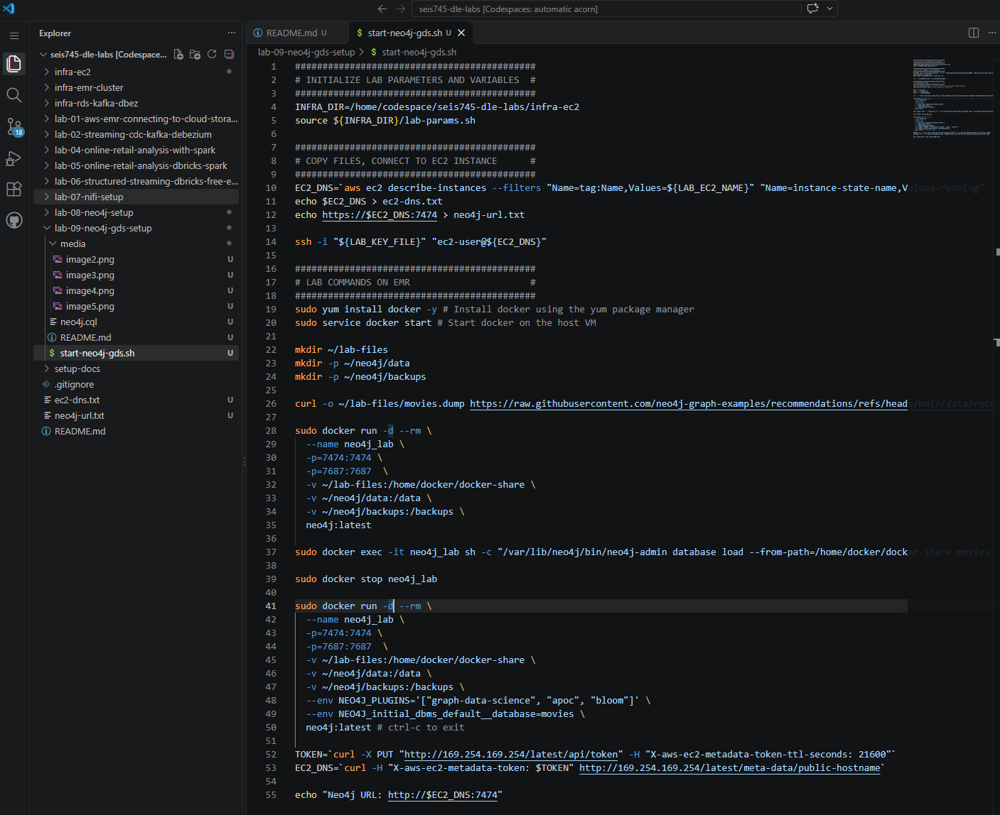
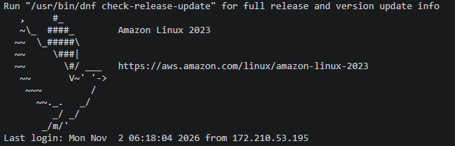
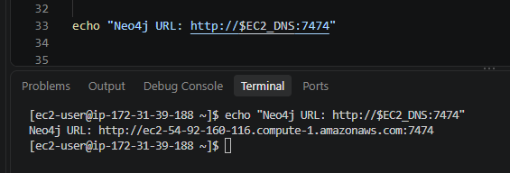
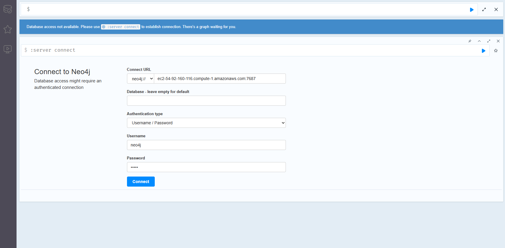
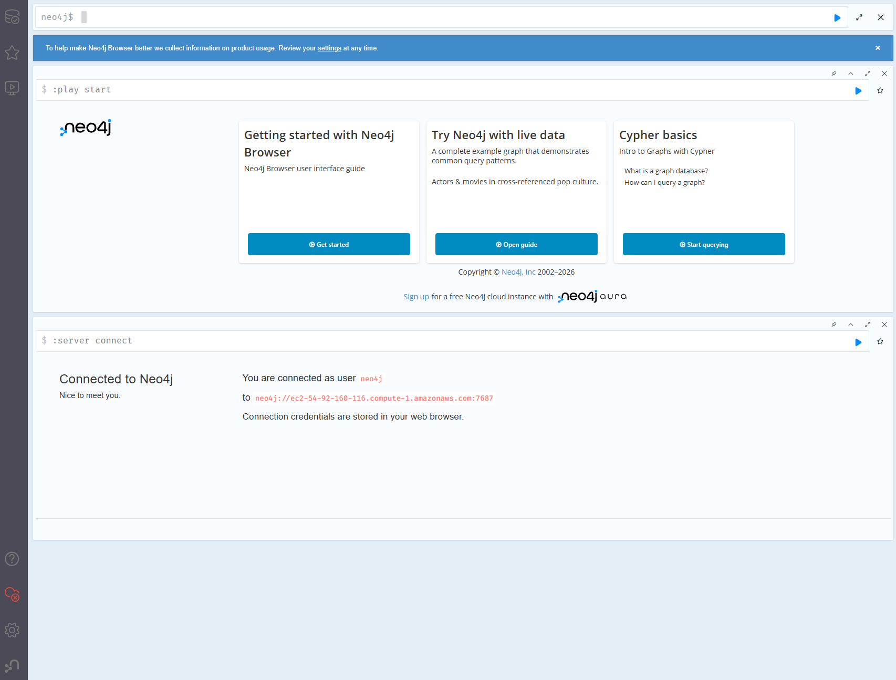

## Introduction

In this lab, you will be starting your own Neo4j database along with Graph Data Science (GDS) extensions.  The database will be running on an AWS EC2 instance.  You will then leverage various graph algorithms to complete the lab and homework assignment.

We will continue to use a GitHub Codespace to automate infrastructure
deployment and interact with cloud resources.

## Pre-requisites

You should have a Codespace environment up and running **in your
browser** with the following git repository cloned and open:
https://github.com/UST-SEIS-745-DLE-Labs/seis745-dle-labs.

Additionally, you should be familiar with the infrastructure as code and
lab conventions we have used previously in class. When running the lab
you will be interactively copying lines from bash scripts and pasting
them into your bash terminal. Pay attention to the code you are
executing and the output as you automate infrastructure
deployment in AWS.

## Section 1: Clone or pull git repository and stand up lab infrastructure

Complete all steps within setup-docs to ensure your AWS lab environment is up and running, your GitHub Codespace is running and accessible in your browser, and you have either cloned ('git clone' in the CLI or command pallete) or pulled the latest changes ('git pull').  The repository url is [**https://github.com/UST-SEIS-745-DLE-Labs/seis745-dle-labs**](https://github.com/UST-SEIS-745-DLE-Labs/seis745-dle-labs)

The directory for this particular lab is **lab-09-neo4j-gds-setup**.

## Section 2: Deploy lab infrastructure

Infrastructure is managed in a separate repo folder for reusability.  This lab relies on the **infra-ec2** folder.  Follow instructions in infra-ec2/README.md (open in GitHub or Open Preview in VS Code / Codespace) to deploy necessary lab infrastructure.

## Section 3: Start Neo4j
Execute commands in the provided start-neo4j-gds.sh script block by block.  Lab commands initialize lab environment variables, connct to the remote EC2 instance using SSH, install docker on that EC2 instance, and run the Neo4j Docker container.

Make sure that SSH works correctly and you see the welcome screen for Amazon Linux:

For convenience, the URL of your Neo4j console is printed to standard out at the end of the script.  Access YOUR url (it will be different than the one in the screenshot) and use default credentials to log in (neo4j / neo4j)

URL printed to standard out:

Neo4j welcome page:

On initial login, set a new password.  Do not select a password that you use for other accounts; this is an insecure lab environment without encryption in transit.  

Once logged in, you should see this page:

## Section 4: Deleting lab resources
Like prior labs, leverage the env-destroy.sh script to delete all AWS resources once you are finished.